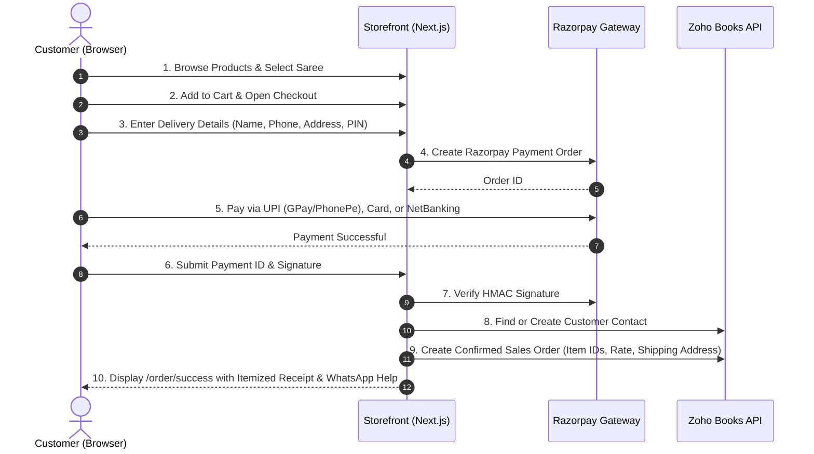

# NiVi E-Commerce: Phase 1 Implementation Plan (Minimal Zero-Dependency Setup)

> [!IMPORTANT]
> **PHASE 1 STRICT BOUNDARIES:**
> 1. 🚫 **NO Custom Fields**: 100% standard Zoho Books item fields only (Name, Rate, Stock on Hand, Description, Native Primary Image). No Zoho field customization needed.
> 2. 🚫 **NO Cloudflare R2 Storage**: Images use Zoho Books native item image only (or fallback). Zero R2 keys, zero S3 setup.
> 3. 🚫 **NO Email Service (No Resend / SMTP)**: Order confirmation is purely on-screen receipt (`/order/success`) + WhatsApp support button. Zero email API keys needed.
> 4. ✅ **ONLY TWO EXTERNAL INTEGRATIONS**:
>    - **Zoho Books** (for Catalog & automatic Sales Order creation)
>    - **Razorpay** (for online payment collection)

---

## 🎯 Phase 1 Objective
Enable customers to **browse products, add to cart, pay via Razorpay, and automatically record the order in Zoho Books** without any third-party storage, custom fields, or email dependencies.

---

## 1. What Data Is Used in Phase 1 (Standard Zoho Items Only)

We rely solely on default fields already present in every Zoho Books item:
- **Product Name**: `raw.name`
- **Selling Price**: `raw.rate`
- **Stock on Hand**: `raw.actual_available_stock` or `raw.stock_on_hand`
- **SKU**: `raw.sku` (if absent, falls back to normalized name or `item_id`)
- **Description**: `raw.description`
- **Image**: Zoho native item image fetched via server proxy `/api/images/zoho/[itemId]` (with local gold/emerald placeholder if no image exists in Zoho).

---

## 2. Customer Order Flow (Phase 1)



---

## 3. Step-by-Step Implementation Checklist

### Step 1: Secure Zoho Image Proxy (Fixes the 401 Unauthorized Error)
- **Problem**: Directly loading `https://zohoapis.in/books/v3/items/.../image` in `` gives a `401 Unauthorized` error because browsers lack Zoho's private OAuth Bearer token.
- **Solution**:
  - Create `/app/api/images/zoho/[itemId]/route.ts`:
    - Server fetches image using `ZohoHttpClient` (authenticated with server OAuth token).
    - Streams binary image with headers: `Content-Type: image/jpeg` and `Cache-Control: public, max-age=86400, stale-while-revalidate=604800`.
  - In `ZohoItemMapper.toDomain`:
    - Set `primaryImageUrl = "/api/images/zoho/" + raw.item_id`.
  - In UI:
    - If item has no image or image fails to load, gracefully display the NiVi peacock gold-halo placeholder.
    - Zero R2 storage required.

---

### Step 2: Admin UI Update — Direct Image File Upload (Replacing URL Input)
- **Problem**: Previously, the Admin product form required manually pasting an external image URL into a text box.
- **Solution in Phase 1**:
  - **Remove URL Input**: Completely delete the `<Input type="url">` field for the primary image.
  - **Direct File Picker & Drag-and-Drop**:
    - Add a sleek image upload dropzone in [components/admin/product-form.tsx](file:///d:/personal/nivi/components/admin/product-form.tsx).
    - Accepts `.jpg`, `.png`, and `.webp` files up to 5MB.
    - Shows an instant client-side thumbnail preview with replace and delete actions.
  - **Native Zoho Upload**:
    - On form submission (or immediate upload), streams the file to Zoho Books via `POST /books/v3/items/{item_id}/image` using multipart/form-data (`image_file`).
  - **Zero Mentions of External Storage**:
    - UI cleanly states **"Primary Image"**.
    - No mentions of Cloudflare R2, S3, presigned links, or raw URLs.

---

### Step 3: Storefront Catalog & Product Page
- Clean, fast, mobile-friendly interface matching the White, Emerald Green (`#0a3d31`), and Antique Gold (`#c5a059`) theme.
- **Catalog Page (`/`)**:
  - Displays product card with photo, name, price (`₹{rate}`), and stock status.
- **Product Detail (`/products/[slug]`)**:
  - High-res primary photo.
  - Selling price (`₹{rate}`).
  - Stock count indicator.
  - "Add to Bag" and "Buy Now" buttons.

---

### Step 4: Shopping Cart
- Client-side drawer ([components/store/cart-sheet.tsx](file:///d:/personal/nivi/components/store/cart-sheet.tsx)) backed by localStorage.
- Instant item quantity adjustment.
- Prevents adding more than available Zoho stock.
- "Proceed to Checkout" button.

---

### Step 5: One-Page Delivery Details Form (`/checkout`)
- Collects only essential Indian delivery info:
  - **Full Name**
  - **Mobile Number** (validated 10-digit Indian number)
  - **Email Address** (used only to identify or create the Zoho customer contact)
  - **Delivery Address** (Street, Flat/Building)
  - **City & State**
  - **PIN Code** (6 digits)
  - Optional delivery instructions

---

### Step 6: Razorpay Checkout Integration
- Route `/api/checkout/create-order`:
  - Validates cart items against current Zoho stock and rate.
  - Calls Razorpay API to generate order `rzp_order_...`.
- Client opens the Razorpay Standard Checkout modal (UPI, Cards, NetBanking).
- On success, sends `razorpay_payment_id`, `razorpay_order_id`, and `razorpay_signature` to `/api/checkout/verify`.

---

### Step 7: Direct Zoho Books Sales Order Creation
Once payment is verified:
1. **Find or Create Contact in Zoho Books**:
   - Query: `GET /books/v3/contacts?email={email}` or `phone={phone}`.
   - If contact exists, use `contact_id`.
   - If not found, create via `POST /books/v3/contacts`:
     ```json
     {
       "contact_name": "Customer Full Name",
       "customer_name": "Customer Full Name",
       "email": "customer@example.com",
       "phone": "9876543210",
       "shipping_address": { ... },
       "billing_address": { ... }
     }
     ```
2. **Create Sales Order in Zoho Books**:
   - `POST /books/v3/salesorders`:
     ```json
     {
       "customer_id": "contact_id",
       "date": "YYYY-MM-DD",
       "line_items": [
         {
           "item_id": "zoho_item_id",
           "quantity": 1,
           "rate": 4500
         }
       ],
       "shipping_address": { ... },
       "notes": "Order placed via NiVi Storefront. Razorpay Payment ID: pay_..."
     }
     ```
   - Automatically decrements Zoho inventory.

---

### Step 8: On-Screen Success Confirmation (`/order/success`)
- **No email required**: Customer is redirected to a confirmation page.
- Displays:
  - Order Reference Number
  - Itemized receipt & total amount paid
  - Delivery address summary
  - Direct **"Track on WhatsApp"** or **"Need Help?"** button with pre-filled order ID linking to NiVi's WhatsApp business number.

---

## 4. Environment Variables for Phase 1 (Minimal Set)

You only need Zoho Books and Razorpay. Leave everything else completely blank:

```env
# ---- 1. Zoho Books (Already configured ✅) ----
ZOHO_CLIENT_ID=1000.1GABD7LYIVAA8D6F9B1W7P4RX7FAZX
ZOHO_CLIENT_SECRET=99d4bdbf8bde7569150613f39cbc78fdc4c337ba48
ZOHO_REFRESH_TOKEN=1000.8d0cd01e8206e816421a93201ba1cd07.8a37db539fb5eb326f392166e159bed2
ZOHO_ORG_ID=60067552423
ZOHO_API_DOMAIN=https://www.zohoapis.in
ZOHO_ACCOUNTS_URL=https://accounts.zoho.in

# ---- 2. Razorpay (For Checkout Payments) ----
RAZORPAY_KEY_ID=rzp_test_...
RAZORPAY_KEY_SECRET=...
RAZORPAY_WEBHOOK_SECRET=...

# ---- 3. Public ----
NEXT_PUBLIC_SITE_URL=http://localhost:3000

# ---- 4. EVERYTHING ELSE LEAVE BLANK (NOT USED IN PHASE 1) ----
# R2_ACCOUNT_ID=
# R2_ACCESS_KEY_ID=
# R2_SECRET_ACCESS_KEY=
# R2_BUCKET_NAME=
# R2_BUCKET_URL=
# RESEND_API_KEY=
# MAIL_FROM=
# GOOGLE_SHEETS_CLIENT_EMAIL=
# GOOGLE_SHEETS_PRIVATE_KEY=
# GOOGLE_SHEET_ID=
```

---

## 5. Ready for the Next Chat!

When you start your new chat, paste this prompt:

> *"I am starting Phase 1 based on `PHASE_1_ORDER_FLOW_PLAN.md`. There are NO custom fields, NO Cloudflare R2, and NO email service. Let's fix the Zoho image proxy route and update the admin media form with direct file upload (no image URL input), then test the complete customer order flow from product selection to Zoho Sales Order creation."*
