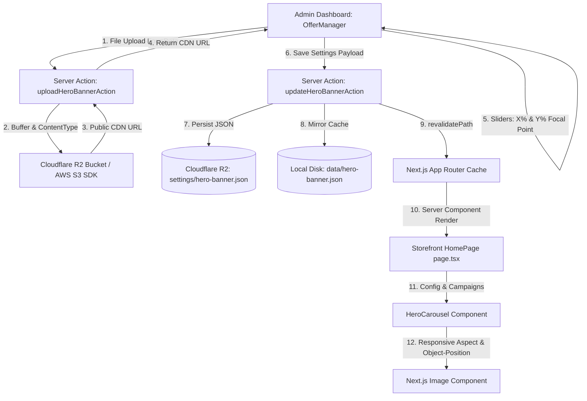

# NiVi — Banner Upload & Framing Architecture (Admin & Public Storefront)

This document provides a comprehensive technical breakdown of how banners are uploaded, framed, positioned, stored, and rendered across both the **Admin Dashboard** and the **Public Storefront**.

---

## 1. System Architecture Overview



---

## 2. Admin Side Logic

### 2.1 Relevant Files
- **UI & Framing Controls**: [`components/admin/offer-manager.tsx`](file:///d:/personal/nivi/components/admin/offer-manager.tsx)
- **Server Actions**: [`app/actions/admin-hero-banner.ts`](file:///d:/personal/nivi/app/actions/admin-hero-banner.ts) & [`app/actions/admin-offers.ts`](file:///d:/personal/nivi/app/actions/admin-offers.ts)
- **Persistence Layer**: [`infrastructure/hero-banner/hero-banner-repository.ts`](file:///d:/personal/nivi/infrastructure/hero-banner/hero-banner-repository.ts)
- **Domain Entity**: [`core/domain/entities/hero-banner.ts`](file:///d:/personal/nivi/core/domain/entities/hero-banner.ts)

---

### 2.2 Upload Pipeline

When an administrator uploads a new image in the modal, it is uploaded directly to Cloudflare R2 via Next.js Server Actions:

```typescript
// app/actions/admin-hero-banner.ts
export async function uploadHeroBannerAction(formData: FormData) {
  await container.adminAuth.requireAdmin();

  const file = formData.get("file") as File;
  const arrayBuffer = await file.arrayBuffer();
  const buffer = new Uint8Array(arrayBuffer);
  const contentType = (file.type || "image/jpeg") as "image/jpeg" | "image/png" | "image/webp";

  // Upload to R2 and return immutable public CDN URL
  const publicUrl = await container.uploadCampaignBanner(buffer, contentType);
  return { success: true, data: { publicUrl } };
}
```

---

### 2.3 Interactive Framing & 2D Focal-Point Adjustment

Because banners are displayed across diverse device viewports (ultrawide desktop to mobile portrait), a static center crop often cuts off models or jewelry. The admin panel provides interactive 2D focal positioning:

#### State Variables:
```typescript
const [heroPositionX, setHeroPositionX] = useState<number>(heroBanner.imagePositionX ?? 85);
const [heroPositionY, setHeroPositionY] = useState<number>(heroBanner.imagePositionY ?? 15);
```

#### Live Frame Preview:
The modal simulates the exact widescreen aspect ratio of the storefront carousel:

```tsx
<div className="relative rounded-xl overflow-hidden border border-border bg-black/5 aspect-[3/1] max-h-48 group">
  
  {/* Position Badge overlay */}
  <div className="absolute bottom-2 left-2 px-2 py-0.5 rounded bg-black/75 text-white text-[10px] font-mono">
    {heroPositionX}% X, {heroPositionY}% Y
  </div>
</div>
```

#### One-Click Preset Buttons:
Administrators can quickly snap focal points to common photo compositions:

| Preset Name | X Position | Y Position | Ideal For |
|---|---|---|---|
| **Model Face (Top-Right)** | `85%` | `15%` | Standing saree model on right, space for text on left |
| **Model Centered** | `50%` | `20%` | Central portrait / head & shoulder drape |
| **Model Left** | `15%` | `20%` | Model on left, right-aligned text |
| **Center Artwork** | `50%` | `50%` | Centered festive graphics / temple architecture |
| **Border / Pleats** | `50%` | `80%` | Focus on zari pallu or border details |

#### Fine-Tuning Sliders:
```tsx
<input
  type="range"
  min="0"
  max="100"
  value={heroPositionX}
  onChange={(e) => setHeroPositionX(parseInt(e.target.value, 10))}
  className="w-full accent-primary h-1.5"
/>
```

---

### 2.4 Mode Switch: Text Overlay vs. Pure Graphic Mode

The admin panel allows switching between two distinct presentation modes:

1. **Text Overlay Mode (`showOverlay: true`)**:
   - The photo serves as the photographic backdrop.
   - Admin configures Tagline, Headline, Subtitle, and Primary/Secondary CTA buttons.
   - Text alignment can be set to `left`, `center`, or `right`.
2. **Pure Graphic Mode (`showOverlay: false`)**:
   - Used when the graphic designer has already baked typography and promotional artwork into the image.
   - Disables text overlays and directional gradients.
   - The whole banner acts as a clean, direct clickable link.

---

### 2.5 Drag-and-Drop Carousel Order Management

The initial hero banner and up to 5 active campaign banners can be reordered in the carousel using drag-and-drop or rank arrows:
- Kanban cards and List rows both support HTML5 drag events (`onDragStart`, `onDragOver`, `onDrop`).
- The order is committed via `reorderCarouselSlidesAction` with zero-indexed `displayOrder` values.

---

## 3. Public Storefront Logic

### 3.1 Relevant Files
- **Hero Carousel Component**: [`components/store/hero-carousel.tsx`](file:///d:/personal/nivi/components/store/hero-carousel.tsx)
- **Home Page Server Component**: [`app/page.tsx`](file:///d:/personal/nivi/app/page.tsx)
- **Configuration Schema**: [`core/domain/entities/hero-banner.ts`](file:///d:/personal/nivi/core/domain/entities/hero-banner.ts)

---

### 3.2 Slide Synthesis & Sorting

In `app/page.tsx`, the server fetches both the initial hero configuration and active offer campaigns:

```typescript
// app/page.tsx
const heroBanner = await heroBannerRepository.get();
const campaigns = await offerCampaignRepository.list();

<HeroCarousel campaigns={campaigns} heroBanner={heroBanner} />
```

In `HeroCarousel`, slides are unified into an array sorted by `displayOrder`:

```typescript
// components/store/hero-carousel.tsx
const slides = useMemo<CarouselSlide[]>(() => {
  const list: CarouselSlide[] = [];

  if (activeHero.active !== false) {
    list.push({
      id: "hero_main",
      type: "hero",
      order: activeHero.displayOrder ?? 0,
      banner: activeHero,
    });
  }

  validCampaigns.forEach((camp, idx) => {
    list.push({
      id: camp.id,
      type: "campaign",
      order: camp.displayOrder ?? idx + 1,
      campaign: camp,
    });
  });

  return list.sort((a, b) => a.order - b.order);
}, [activeHero, campaigns]);
```

---

### 3.3 Responsive Frame Dimensions

The outer frame container uses responsive height breakpoints to ensure the banner maintains visual impact across mobile, tablet, and widescreen monitors:

```tsx
<div
  className="relative w-full overflow-hidden rounded-2xl sm:rounded-3xl shadow-xl select-none
             h-[210px] xs:h-[260px] sm:h-[380px] md:h-[460px] lg:h-[520px] xl:h-[560px]
             max-w-7xl mx-auto"
>
```

---

### 3.4 Image Rendering & `objectPosition` Application

The focal point set in the admin panel is passed directly to the CSS `objectPosition` property:

```tsx
<Image
  src={heroImgSrc}
  alt={banner.title || "NiVi Luxury Handcrafted Silk Sarees"}
  fill
  priority={idx === 0}
  unoptimized
  sizes="(max-width: 1280px) 100vw, 1280px"
  className="object-cover brightness-[0.92]"
  style={{
    objectPosition: `${banner.imagePositionX}% ${banner.imagePositionY}%`,
  }}
/>
```

#### Why This Works:
- `fill` + `object-cover` causes the image to scale and crop naturally to fit any container width/height.
- `objectPosition: "85% 20%"` locks the model's face and upper drape in view, trimming away only unimportant ambient background on narrow screens.

---

### 3.5 Contrast Gradients for Text Readability

When `showOverlay === true`, a directional gradient protects text legibility based on the configured `textPosition`:

```tsx
{/* Left-aligned text overlay */}
{textPos === "left" && (
  <div className="absolute inset-0 bg-gradient-to-r from-black/90 via-black/60 to-transparent w-[65%] sm:w-[55%] md:w-[50%]" />
)}

{/* Right-aligned text overlay */}
{textPos === "right" && (
  <div className="absolute inset-0 left-auto right-0 bg-gradient-to-l from-black/90 via-black/60 to-transparent w-[65%] sm:w-[55%] md:w-[50%]" />
)}

{/* Centered text overlay */}
{textPos === "center" && (
  <div className="absolute inset-0 bg-black/45 backdrop-blur-[0.5px]" />
)}
```

---

## 4. Key Configuration Schema Reference

```typescript
export interface HeroBannerConfig {
  imageUrl: string;                  // Cloudflare R2 CDN URL or local public path
  active: boolean;                   // Toggle visibility without deleting
  displayOrder: number;              // Slide order index (0 = first slide)
  tagline?: string | null;           // Badge text, e.g. "Royal Festive Edit"
  title?: string | null;             // Main headline
  subtitle?: string | null;          // Editorial paragraph
  primaryCtaText?: string | null;    // e.g. "Explore Sarees"
  primaryCtaLink?: string | null;    // Target route, e.g. "/collections"
  secondaryCtaText?: string | null;  // e.g. "Heritage Edit"
  secondaryCtaLink?: string | null;  // Target route
  showOverlay: boolean;              // true = Text Overlay, false = Pure Graphic
  textPosition: "left" | "center" | "right";
  imagePositionX: number;            // 0 - 100 percentage
  imagePositionY: number;            // 0 - 100 percentage
  objectPosition: string;            // e.g. "85% 20%"
  updatedAt?: string;
}
```

---

## 5. Summary Table: Admin vs. Public Logic

| Feature | Admin Panel (`offer-manager.tsx`) | Storefront (`hero-carousel.tsx`) |
|---|---|---|
| **Aspect Ratio Frame** | Fixed `aspect-[3/1]` max-height preview box | Responsive height (`h-[210px]` to `h-[560px]`) |
| **Focal Adjustment** | Sliders (0-100%) & 5 quick presets | Applied via `style={{ objectPosition }}` |
| **Image Upload** | Direct R2 upload via `FormData` action | Reads immutable CDN / local URL |
| **Reordering** | Drag-and-drop & rank arrow controls | Automatically sorted by `order = displayOrder` |
| **Overlay Toggle** | Segmented button ("Text Overlay" vs "Pure Graphic") | Conditional JSX: `<Link>` wrapper vs overlay text container |
| **Cache Invalidation** | Calls `revalidatePath("/")` on save | Immediately serves updated banner on page load |
